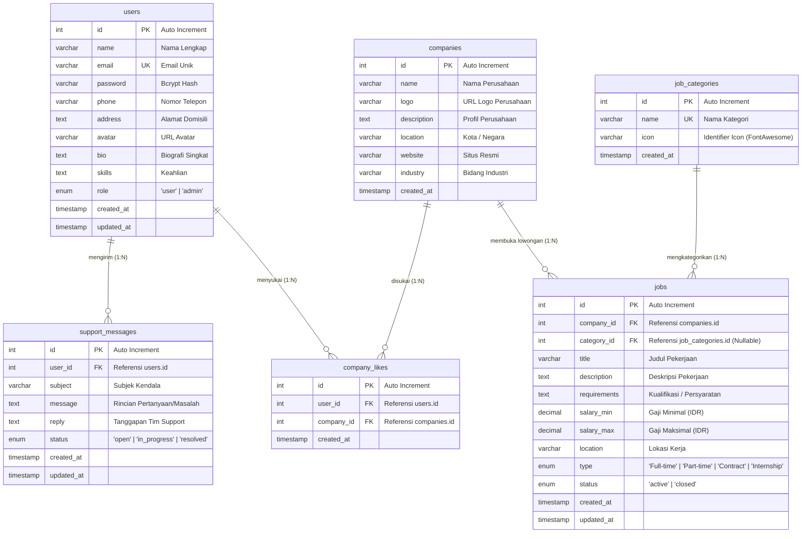

# 📐 Entity Relationship Diagram (ERD) — LearnHire (Versi Sederhana)

Dokumen ini memuat spesifikasi lengkap perancangan basis data **LearnHire** versi sederhana (Job Portal), mencakup diagram ERD konseptual dan logikal, kamus data (*data dictionary*), relasi antar tabel, kardinalitas, serta analisis normalisasi.

---

## 1. Visualisasi Diagram ERD (Mermaid)

---

## 2. Kamus Data & Relasi Entitas (Data Dictionary)

### A. Entitas Inti (Core Entities)
1. **`users`**
   - **Deskripsi:** Menyimpan kredensial dan profil pengguna (pencari informasi lowongan kerja) serta administrator sistem.
   - **Kunci Utama (PK):** `id` (INT AUTO_INCREMENT)
   - **Kunci Unik (UK):** `email` (Mencegah pendaftaran ganda)
   - **Catatan:** Kolom `cv_url` telah dihapus karena fitur lamaran kerja tidak tersedia pada versi ini.

2. **`companies`**
   - **Deskripsi:** Menyimpan profil badan usaha atau perusahaan yang menerbitkan lowongan karir.
   - **Kunci Utama (PK):** `id` (INT AUTO_INCREMENT)
   - **Catatan:** Kolom `founded_year` dan `employee_count` telah dihapus untuk penyederhanaan.

3. **`jobs`**
   - **Deskripsi:** Lowongan pekerjaan aktif maupun arsip dari perusahaan mitra.
   - **Kunci Utama (PK):** `id` (INT AUTO_INCREMENT)
   - **Foreign Keys:**
     - `company_id` → `companies(id)` (ON DELETE RESTRICT, ON UPDATE CASCADE)
     - `category_id` → `job_categories(id)` (ON DELETE SET NULL, ON UPDATE CASCADE)
   - **Catatan:** Kolom `responsibilities`, `experience_level`, dan `deadline` telah dihapus. Enum `type` tidak lagi memiliki opsi 'Remote'. Enum `status` tidak lagi memiliki opsi 'draft'.

---

### B. Entitas Referensi (Reference / Lookup)
1. **`job_categories`**
   - **Deskripsi:** Menyimpan kategori industri/bidang pekerjaan.
   - **Kunci Utama (PK):** `id` (INT AUTO_INCREMENT)
   - **Kunci Unik (UK):** `name` (Mencegah duplikasi nama kategori)
   - **Catatan:** Kolom `description` telah dihapus untuk penyederhanaan.

---

### C. Entitas Penghubung / Transaksional (Junction & Transactional)
1. **`company_likes`** *(Many-to-Many Resolver antara `users` & `companies`)* — **TABEL BARU**
   - **Deskripsi:** Menyimpan data Like pengguna terhadap perusahaan yang diminati. Unlike dilakukan dengan DELETE baris. Total Like dihitung dinamis dengan COUNT(*).
   - **Kunci Utama (PK):** `id` (INT AUTO_INCREMENT)
   - **Unique Constraint:** `(user_id, company_id)` memastikan 1 pengguna hanya dapat memberikan 1 Like per perusahaan.
   - **Foreign Keys:**
     - `user_id` → `users(id)` (ON DELETE CASCADE, ON UPDATE CASCADE)
     - `company_id` → `companies(id)` (ON DELETE CASCADE, ON UPDATE CASCADE)

2. **`support_messages`**
   - **Deskripsi:** Tiket bantuan layanan pelanggan (*customer support/helpdesk*).
   - **Kunci Utama (PK):** `id` (INT AUTO_INCREMENT)
   - **Foreign Key:** `user_id` → `users(id)` (ON DELETE CASCADE, ON UPDATE CASCADE)
   - **Catatan:** Kolom `priority` dan opsi status 'closed' telah dihapus.

---

### D. Entitas yang Dihilangkan (Tidak Ada pada Versi Ini)

| Tabel Lama | Alasan Penghapusan |
|:-----------|:-------------------|
| `job_applications` | Fitur lamaran kerja dihilangkan; pengguna hanya melihat info lowongan |
| `course_categories` | Seluruh fitur kursus online dihilangkan |
| `courses` | Seluruh fitur kursus online dihilangkan |
| `course_enrollments` | Seluruh fitur kursus online dihilangkan |

---

## 3. Analisis Kardinalitas & Integritas Relasi

| Relasi Tabel | Jenis Kardinalitas | Penjelasan Bisnis |
| :--- | :---: | :--- |
| `companies` → `jobs` | **1 : N** (One-to-Many) | Satu perusahaan dapat mempublikasikan banyak lowongan pekerjaan. |
| `job_categories` → `jobs` | **1 : N** (One-to-Many) | Satu kategori pekerjaan memayungi beragam posisi lowongan. |
| `users` ↔ `companies` | **M : N** (Many-to-Many via `company_likes`) | Seorang pengguna dapat menyukai banyak perusahaan, dan satu perusahaan dapat disukai oleh banyak pengguna. |
| `users` → `support_messages` | **1 : N** (One-to-Many) | Seorang pengguna dapat mengajukan lebih dari satu tiket bantuan kendala. |

---

## 4. Analisis Normalisasi Basis Data

1. **Bentuk Normal Pertama (1NF):**
   - Setiap kolom hanya memuat nilai skalar tunggal (*atomic value*).
   - Tidak ada baris duplikat (setiap tabel memiliki Primary Key eksplisit).
2. **Bentuk Normal Kedua (2NF):**
   - Telah memenuhi 1NF.
   - Semua atribut non-kunci bergantung penuh secara fungsional (*functional dependency*) terhadap keseluruhan Primary Key, tidak ada ketergantungan parsial.
3. **Bentuk Normal Ketiga (3NF):**
   - Telah memenuhi 2NF.
   - Tidak ada ketergantungan transitif (*transitive dependency*), yaitu atribut non-kunci yang bergantung pada atribut non-kunci lainnya. Kategori, perusahaan, dan likes dipisah ke tabel relasional mandiri.

---

## 5. File Referensi Pendukung
- **SQL Schema Siap Pakai:** [`database1/schema.sql`](../schema.sql) (Telah dilengkapi seed data untuk demo dan presentasi)
- **Interactive Web ERD Viewer:** Buka file [`database1/erd/erd.html`](./erd.html) pada browser untuk melihat diagram interaktif secara grafis.
